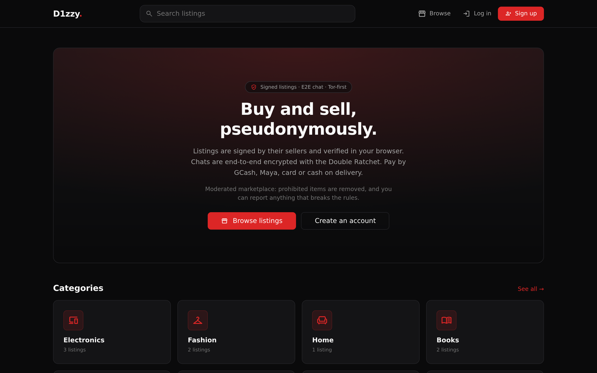
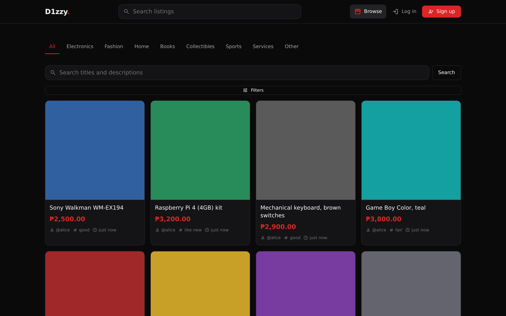
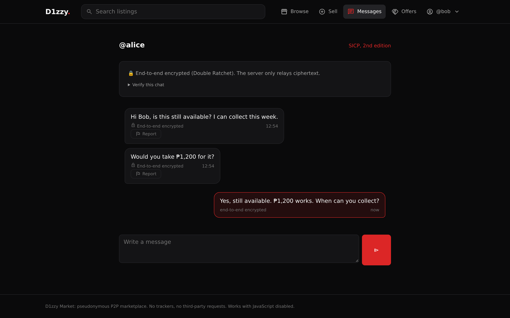
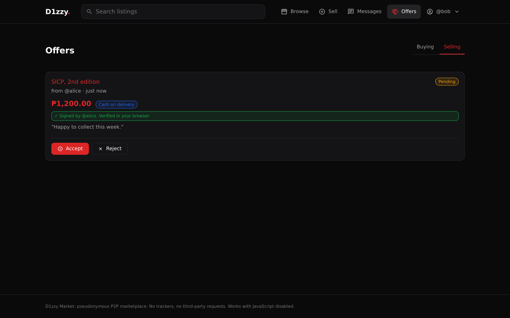

# D1zzy Market

[](https://github.com/AlasdairDev/project-d1zzy/actions/workflows/security.yml)
[](LICENSE)
[](pyproject.toml)

D1zzy Market is a personal project: a marketplace prototype for second-hand electronics,
books, clothing and similar goods. It runs as a Tor onion service, and the part I care about
is the trade-off between privacy and the normal things a marketplace has to do. Prices are
in PHP. Listings and offers are signed in the browser. Chat can be end-to-end encrypted.
Moderation leaves a written record.

I built it to answer a question. How much does a marketplace need to know about the people
using it? The rest of this README is what that choice cost, what works, and what is still
unfinished.

## Why I built this

I am using this project to get better at information assurance and security engineering. A
marketplace was a useful excuse because it touches identity, payments, abuse handling, key
management and operations. I did not want to build another to-do app with a login page.

The parts I found most interesting were the ones I did not understand at first. They were the
Double Ratchet, checking signatures in the browser, and the difference between "encrypted at
rest" and "the server cannot read it." The parts I liked least were dependency pins and
migration edge cases. That is probably the most honest summary of the project.

- **Signed content.** Every listing, offer, rating and report is signed with the author's
  Ed25519 key. The browser re-checks each signature itself rather than trusting the server.
- **End-to-end encrypted chat.** Messages use the Double Ratchet over a WebSocket relay.
  The server stores and forwards ciphertext it cannot read.
- **Encrypted at rest.** Listing, offer and rating data, and every image on IPFS, is
  encrypted (XChaCha20-Poly1305).
- **Payments.** Prices are in PHP, and cash on delivery is the default. GCash, Maya and card
  payments go through PayMongo when it is configured. The Stripe, BTCPay and Monero adapters
  are still in the code, but this demo does not use them.
- **Moderation.** Users report listings, users and messages. Moderators hide or unhide
  listings, suspend or warn users, delete messages and resolve disputes. Every action
  needs a reason and goes into an audit log. Content can be removed: this is a moderated
  market, not a "no censorship" one.
- **Works with JavaScript disabled** (Tor Browser at "Safest"). Every form posts as plain
  HTML. Chat falls back to auto-refresh. Nothing loads from a third-party host.

## Screenshots

| | |
|---|---|
|  |  |
|  |  |

The vendor dashboard, moderation queue, encryption settings and profile page are in
[`docs/screenshots/`](docs/screenshots/). Every screenshot uses the seeded demo data and
prices in Philippine pesos.

**Contents:** [Quick start](#quick-start-aurora-dx--any-fedora-atomic-host) ·
[Commands](#commands) · [Payments](#payments-philippines) · [Security model](#security-model) ·
[Security assurance](#security-assurance) · [Architecture](#architecture) ·
[Layout](#layout) · [Contributing](#contributing)

## Quick start (Aurora DX / any Fedora Atomic host)

```bash
# Browsers
flatpak install -y flathub app.zen_browser.zen org.torproject.torbrowser-launcher

# In the project directory
just dev            # makes .env with random keys, builds, starts, waits until healthy
just seed           # optional: demo data (SEED_DEMO_DATA=true already seeds on start)
just zen            # opens http://localhost:8000 in Zen
just onion          # prints the .onion address -> open it in Tor Browser (`just tor-browser`)
```

`just dev` stops any containers left running by the old `project-d1zzy` compose stack.
It stops them but does not delete them or their volumes.

| URL | What |
|-----|------|
| http://localhost:8000 | The market |
| http://localhost:8000/api/docs | OpenAPI docs (development mode only) |
| http://localhost:8025 | Mailpit: catches verification and password-reset emails |

### Demo accounts (after seeding)

| Account | Password | Role |
|---------|----------|------|
| `mod@d1zzy.local` | `demo-password-123` | moderator, opens `/moderation` |
| `alice@`, `bob@`, `carol@d1zzy.local` | `demo-password-123` | vendors |
| `dave@d1zzy.local` | `demo-password-123` | buyer |

The vendors' encryption passphrase is `correct horse battery staple`. Enter it when the
site asks you to unlock your keys.

These accounts and listings are local demo data. They are not credentials for a deployed
instance.

The demo is Philippines-only: every listing is priced in PHP and the default payment
method is cash on delivery.

### Walkthrough

1. Register. In **Settings**, choose an encryption passphrase, then click **Become a vendor**.
2. **Sell**: add a title, price and photos. With your keys unlocked, the browser encrypts
   the photos, uploads ciphertext to IPFS, then seals and signs the listing.
3. As another user, open the listing and **Make an offer**. The offer is signed by the buyer.
4. The seller **accepts** under Offers → Selling. With cash on delivery the buyer pays on
   handover. With PayMongo keys configured, the buyer can choose GCash, Maya or card and
   click **Pay now**.
5. Click **Message** on the listing to start an end-to-end encrypted chat.
6. For an online-paid offer, when the buyer clicks **I received it**, both sides can **rate**
   each other.
7. Log in as `mod@d1zzy.local`, report something, then hide it from `/moderation`. The
   audit log at the bottom of that page records the action.

## Commands

Run `just` to list every recipe. The main ones:

| Recipe | What it does |
|--------|--------------|
| `just dev` / `just down` | start and stop the core stack |
| `just dev-crypto` | optional Monero adapter (not used in the Philippines-only demo) |
| `just btcpay-up` | optional BTCPay adapter (not used in the demo) |
| `just logs app` / `just ps` / `just shell` / `just psql` | look inside the stack |
| `just seed` / `just create-moderator EMAIL PW` / `just create-vendor EMAIL PW` | data and accounts |
| `just test` | full test-suite against real Postgres, Redis, IPFS and Monero containers |
| `just test-fast` | the same without the ~40 s Monero multisig test |
| `just test-container` | run the tests inside containers (`deploy/compose/podman-compose.test.yml`) |
| `just lint` / `just fmt` / `just icons` | code quality; re-subset the icon font after adding an icon |
| `just quadlet-install` / `quadlet-start` / `quadlet-status` | run as systemd user services |
| `just nuke` | delete all stack data (asks first) |

## Payments (Philippines)

Listings are priced in PHP. The buyer flow offers local methods only:

| Method | How it works |
|--------|--------------|
| Cash on delivery | Default. Buyer and seller arrange handover. No provider involved. |
| GCash | Optional, through PayMongo. |
| Maya | Optional, through PayMongo. |
| Card or bank transfer | Optional, through PayMongo. |

PayMongo is enabled when `PAYMONGO_SECRET_KEY` starts with `sk_`. Add the keys to `.env` and
run `just restart app`. Without keys, the offer form defaults to cash on delivery and the
PayMongo options are labelled "not set up on this server".

PayMongo checkout is wired, but webhook confirmation is not built yet. The demo therefore
uses cash on delivery; a PayMongo test payment would stay pending until it is confirmed.
Cash on delivery orders are arranged directly between the buyer and seller, and the demo
does not mark them paid automatically.

The vendor dashboard shows what each seller is owed. Automated payouts are not built.

### Optional adapters

The codebase still contains Stripe, BTCPay and Monero adapters for self-hosted experiments,
and `just stripe-listen`, `just btcpay-up` and `just dev-crypto` remain available. They are
not configured here and are not part of the Philippines-only flow.

## Security model

Here is what the server can see, in plain terms. I wrote it this way because the limits
matter more than the feature list. Read it before trusting the platform with anything real.

| Data | Who can read it |
|------|-----------------|
| **Messages** (with JS and keys on both sides) | Only the two participants. Double Ratchet; the server relays ciphertext. |
| **Messages** sent without JS, or when a partner has no keys | The server. These are encrypted at rest and labelled "not end-to-end encrypted" in the UI. |
| **Listings, offers, ratings** | Anyone who can reach the site, by design, because they are public. They are encrypted at rest with `MARKET_KEY`, so a database dump or backup alone reveals nothing. |
| **Images on IPFS** | Nobody without the per-image key, which is stored inside the encrypted listing. |
| **Your passphrase and secret keys** | Only your browser. The passphrase is stretched with Argon2id, and only public keys are uploaded. |
| **Search queries** (with JS) | Only your browser: Fuse.js searches the decrypted index locally. Without JS the server sees the query, and the page says so. |

- **Signatures** make tampering visible: a server that changes a listing cannot forge the
  seller's signature. Content posted without JavaScript is signed by the server on the
  user's behalf, and the page shows it as **server-signed** instead.
- **Safety numbers** let two users compare a 60-digit fingerprint of both identity keys
  over another channel. If a server swaps a key, the numbers will not match.
- **Reporting a message** discloses that message's plaintext to moderators. It is the only
  way moderators ever see end-to-end encrypted content.
- **The ratchet bootstrap has no prekey server.** The first shared secret comes from the
  two parties' static identity keys and the conversation id. Forward secrecy starts with
  the first DH ratchet step. Ratchet state lives in one browser, so other devices cannot
  read history.
- **No IP addresses are stored or logged.** Logs contain method, path, status and timing
  only. IPFS runs `--offline`, because an onion service that joins the public IPFS DHT
  announces its real IP. The onion service enables Tor's proof-of-work defences and caps
  concurrent streams.
- **Headers.** A strict CSP (no `unsafe-inline` or `unsafe-eval`; Alpine runs as its CSP
  build), `frame-ancestors 'none'`, `no-referrer`, signed double-submit CSRF tokens,
  SameSite=Lax HttpOnly cookies, and an `Onion-Location` header on clearnet responses.
- **Rate limiting** is per user when logged in. Over Tor, all anonymous traffic shares one
  bucket.
- **Back up `MARKET_KEY`.** Without it, stored listings cannot be decrypted. It lives in
  `.env`, not in the database.

## Security assurance

I wrote the security work down instead of leaving it in commit messages:

| Document | What is in it |
|----------|---------------|
| [`SECURITY.md`](.github/SECURITY.md) | Disclosure policy, scope, safe harbour and operator hardening |
| [`docs/security/THREAT-MODEL.md`](docs/security/THREAT-MODEL.md) | Assets, adversaries, trust boundaries, STRIDE, attack trees, privacy analysis and the risks I accept |
| [`docs/security/CONTROLS-MATRIX.md`](docs/security/CONTROLS-MATRIX.md) | OWASP ASVS 4.0.3 Level 2, NIST CSF 2.0 and ISO 27001:2022 Annex A, with evidence for every status and a gap register |
| [`docs/security/SECURITY-ASSESSMENT.md`](docs/security/SECURITY-ASSESSMENT.md) | What the review found, what changed, what remains open, and how to reproduce it |
| [`docs/security/CASE-STUDY.md`](docs/security/CASE-STUDY.md) | The short version: why the project exists and what the assessment taught me |
| [`docs/security/IR-PLAN.md`](docs/security/IR-PLAN.md) | Severity levels, incident playbooks and a tabletop exercise record |
| [`docs/security/KEY-MANAGEMENT.md`](docs/security/KEY-MANAGEMENT.md) | Key inventory, rotation, backup and destruction |
| [`docs/security/VULN-MANAGEMENT.md`](docs/security/VULN-MANAGEMENT.md) | Triage SLAs, accepted advisories and the exception process |
| [`docs/security/SUPPLIER-REGISTER.md`](docs/security/SUPPLIER-REGISTER.md) | What Tor, IPFS, payments and base images see, and how to exit |
| [`docs/security/BIA.md`](docs/security/BIA.md) | Recovery targets, backup plan and the restore drill |
| [`docs/security/PRIVACY.md`](docs/security/PRIVACY.md) | Data map, retention schedule, DPIA-lite and data subject requests |
| [`docs/security/METRICS.md`](docs/security/METRICS.md) | The numbers behind the assurance claims |
| [`docs/policy/TRUST-AND-SAFETY.md`](docs/policy/TRUST-AND-SAFETY.md) | Prohibited content, abuse taxonomy and enforcement |
| [`docs/guides/USER-SECURITY-GUIDE.md`](docs/guides/USER-SECURITY-GUIDE.md) | How users verify the address, compare safety numbers and spot scams |

The full index, including policy and user-facing guides, is in [`docs/README.md`](docs/README.md).

`tests/security/test_security.py` holds the regression tests for the browser controls, CSRF, RBAC,
signatures, AEAD and the request-size cap. Run the checks with:

```bash
just test-fast     # 94 passed, 1 skipped (Monero)
just security      # Ruff, Bandit, pip-audit and gitleaks
```

`just security --strict` fails on dependency advisories and Semgrep findings. It is meant for
release branches. The current open dependency findings are in the assessment, including the
`fastapi-users` exact pins that hold back `pyjwt` and `python-multipart`.

## Architecture

```
Browser (HTMX + Alpine CSP build + libsodium WASM)      Tor Browser "Safest" (no JS)
   │ signed/sealed blobs, ratchet ciphertext                │ plain HTML forms
   ▼                                                        ▼
FastAPI app  ── Jinja templates · JSON API · WebSocket relay (Redis pub/sub rooms)
   │  fastapi-users (JWT in HttpOnly cookies + refresh) · CSRF · CSP · rate limit
   ├── PostgreSQL 16 (SQLAlchemy async, Alembic)
   ├── Redis 7 (Arq queue, pub/sub, notifications, rate-limit counters)
   ├── Kubo IPFS (offline; ciphertext only)
   ├── PayMongo (GCash, Maya, cards) · cash on delivery
   ├── optional Stripe · BTCPay · monero-wallet-rpc adapters (disabled)
   └── Arq worker: send_email, pin_cids, relay_notifications, expire_offers
Tor sidecar (v3 onion → app:8000) · optional ngrok clearnet tunnel
```

## What I changed from the original plan

| Spec | Built | Reason |
|------|-------|--------|
| AES-GCM | XChaCha20-Poly1305 | libsodium's WASM build has no AES-GCM (it needs AES-NI). XChaCha20 is the libsodium default on both sides. |
| `libsodium-wasm@0.7.13` | libsodium-wrappers-sumo 0.7.15, bundled with esbuild into `vendor/libsodium.wasm.js` | That package and URL do not exist. The WASM is embedded in the bundle, so there is no separate `.wasm` file. |
| `@signalapp/libsignal-client` UMD | Our own Double Ratchet: `static/js/ratchet.js`, with a Python twin in `app/core/ratchet.py` | libsignal-client is a native Node module with no browser build. Tests check that the JS and Python implementations interoperate byte for byte. |
| Tailwind CDN at runtime | Hand-written CSS on design tokens (`static/css/`), no build step | The CDN runtime needs JavaScript and `style-src 'unsafe-inline'`, which breaks no-JS and strict CSP. |
| `ipfshttpclient` | `httpx` against the Kubo RPC | ipfshttpclient is unmaintained and refuses Kubo 0.8 and later. |
| `fastapi-csrf-protect` | Small signed double-submit CSRF in `core/security.py` | It needs to handle both HTMX headers and hidden form fields. |
| Monero testnet, daemon and wallet flags on one port | Regtest, separate monerod and wallet-rpc containers, opt-in profile | Testnet needs a multi-hour sync, and the spec's flags collided. |
| BTCPay image with `BTCPAYGEN_*` variables | bitcoind regtest + NBXplorer + BTCPay overlay | Those variables belong to the btcpayserver-docker generator. The bare image never became healthy, which would have blocked the app from starting. |
| Schema "exact" | Small additions | `users.handle` (a public pseudonym instead of the email); `listings.category` extracted (the spec's index on a BYTEA blob is invalid SQL); reports and moderation `target_id` as TEXT (message ids are BIGSERIAL); read markers on conversations; `ratings.offer_id`/`score` so there is one rating per order; a `resolve_dispute` action. |

## Layout

The tree is split by responsibility: `app/` is everything the application serves,
`deploy/` is everything about building and running it, `docs/` is the written assurance
work, and `tests/` mirrors the code's security and integration boundaries. The repository
root holds only project-wide configuration plus the README and licence; community health
files live in `.github/`.

```
.
├── app/                      application package
│   ├── main.py               app factory, middleware, error pages, /healthz
│   ├── config.py             settings (.env)
│   ├── core/                 crypto, ratchet, domain logic, security, payments, ipfs, queue
│   ├── api/
│   │   ├── deps.py           fastapi-users wiring, auth dependencies, render helpers
│   │   ├── routes/           auth, listings, offers, messages, ratings, reports, moderation, users
│   │   └── websocket.py      Double Ratchet relay
│   ├── db/                   async engine, session and model base
│   ├── models/               SQLAlchemy models
│   ├── schemas/              Pydantic request and response models
│   ├── workers/              Arq settings and tasks
│   ├── templates/            Jinja pages and partials (no inline JS)
│   ├── static/
│   │   ├── css/              design tokens, base, layout and component styles
│   │   ├── js/               crypto.js, ratchet.js, app.js (Alpine components)
│   │   └── vendor/           htmx, Alpine CSP build, Fuse, libsodium bundle, icon font
│   └── cli.py                seed, create-moderator, create-vendor, xmr-mine
├── alembic/                  database migrations (alembic.ini at the root)
├── deploy/
│   ├── compose/              development stack, test stack and BTCPay overlay
│   ├── docker/               app image, entrypoint, Tor sidecar, BTCPay image
│   └── quadlet/              systemd user units for Podman
├── docs/
│   ├── README.md             documentation index
│   ├── CHANGELOG.md          release history
│   ├── guides/               user-facing guides
│   ├── policy/               trust and safety, transparency reporting
│   ├── screenshots/          UI screenshots used in the README
│   └── security/             threat model, controls matrix, assessment, runbooks
├── scripts/
│   ├── assets/fonts/         source icon font for `just icons` (never served)
│   ├── security_scan.sh      lint, Bandit, pip-audit, gitleaks, optional Semgrep
│   └── subset_icons.py       rebuild the served icon font subset
├── tests/
│   ├── security/             CSRF, RBAC, crypto and header regressions
│   ├── integration/          routes, database, payments and no-JS tests
│   └── js/                   browser crypto harness (runs in Node)
├── .github/                  issue templates, security workflow, community policies
├── README.md                 project overview and operating guide
├── LICENSE                   MIT
├── justfile                  task runner; run `just` to list every recipe
├── pyproject.toml            dependencies and Ruff/pytest configuration
└── alembic.ini               Alembic entry point
```

## What I would fix next

The open items are in the [assessment](docs/security/SECURITY-ASSESSMENT.md): upgrade the
login libraries and Starlette, add a way to revoke stolen login tokens, finish the PayMongo
confirmation step, and replace the solid-colour demo images with real ones. I would not run
this with real money until those are done.

## What I am still learning

I am still learning how to make a security claim someone else can check. Reading a dependency
graph without panicking is another one. And I have not finished working out how to design
moderation that does not turn into a backdoor.

## Contributing

See [`CONTRIBUTING.md`](.github/CONTRIBUTING.md) for setup, checks and pull request
expectations. For a suspected vulnerability, follow
[`SECURITY.md`](.github/SECURITY.md). Do not open a public issue. Release history is in
[`docs/CHANGELOG.md`](docs/CHANGELOG.md).

## License

MIT. See [`LICENSE`](LICENSE).
