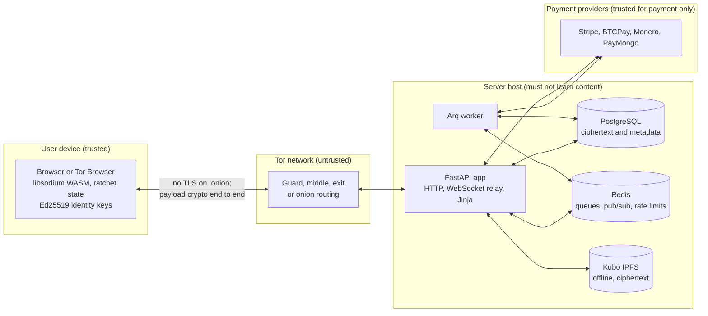

# Threat model: D1zzy Market

| | |
|---|---|
| Version | 1.0 |
| Date | 2026-11-15 |
| Owner | Project maintainer (self-assessment) |
| Method | STRIDE per trust boundary, asset and privacy analysis, attack trees, code review |
| Review | On every architecture change, and at least once per release |
| Related | [Controls matrix](CONTROLS-MATRIX.md), [Security assessment](SECURITY-ASSESSMENT.md), [Security policy](../../.github/SECURITY.md) |

This is what D1zzy protects, who it protects it from, and which controls do the work. It
also says what is not protected. That last part matters as much as the rest.

I wrote this to make myself name the assets and attackers instead of waving at them. It is
the document I come back to when a feature looks simple and turns out to touch three trust
boundaries.

## 1. System overview

D1zzy is a pseudonymous peer-to-peer marketplace that runs as a Tor onion service. There
are two client modes.

With JavaScript and keys (Tor Browser at Standard or Safer), the browser seals listing,
offer and rating plaintext with the marketplace key, signs it with the user's Ed25519 key,
and encrypts chat with a Double Ratchet. The server stores ciphertext.

Without JavaScript (Tor Browser at Safest), the user gets plain HTML forms. The server seals
and signs for them with `SERVER_SIGNING_SEED`. Chat is encrypted at rest but not end to end,
and the UI says so.



The server is not trusted with content. Tor gives transport anonymity, not confidentiality
of what users write.

## 2. Assets

| ID | Asset | Where it lives | Confidentiality | Integrity | Availability |
|----|-------|----------------|-----------------|-----------|--------------|
| A1 | Message plaintext | Browser only (E2E). Server sees ciphertext | High | High | Low |
| A2 | Listing, offer and rating plaintext | Client plus `MARKET_KEY`-sealed blobs in the DB | Medium | High | Medium |
| A3 | Listing images | Client. Per-image key sealed inside the listing. IPFS has ciphertext | High | Medium | Low |
| A4 | Ed25519 identity keys and passphrase | Browser only. Argon2id-derived | High | High | Low |
| A5 | Account data (email, handle, password hash, role) | PostgreSQL | Medium | High | High |
| A6 | Chat ratchet state | One browser | High | High | Low |
| A7 | Platform secrets (`SECRET_KEY`, `MARKET_KEY`, `SERVER_SIGNING_SEED`) | Server env or `.env` | High | High | High |
| A8 | Payment identifiers and amounts | DB and payment provider | Medium | High | High |
| A9 | Moderation audit log | PostgreSQL | Medium | High | Medium |
| A10 | Onion service private key | Tor sidecar volume | High | High | Medium |
| A11 | Network metadata | Minimised. No IPs logged | Low | n/a | n/a |

## 3. Actors and adversary model

| Actor | Capability | Goal | In model? |
|-------|------------|------|-----------|
| Pseudonymous user | Normal account, own keys | Trade without linking to a real identity | Yes |
| Malicious buyer or seller | Full client control, can craft requests and run their own JS | Fraud, scams, harassment, forged content, reading others' data | Yes |
| Curious server operator | Reads DB, Redis, logs and memory. Controls the app | Learn content, link identities | Yes |
| Fully compromised server | Can change code and responses | Forge content, serve malicious JS, de-anonymise users | Partly. Signatures and client checks limit the damage |
| Database or backup thief | Offline copy of PostgreSQL and IPFS | Recover content and credentials | Yes |
| Passive network observer on clearnet | Sees traffic if the app is exposed over HTTPS or ngrok | Read or modify traffic, learn the IP | Yes. Clearnet is optional and documented |
| Global passive Tor adversary | Observes many Tor links | Correlate the onion service with a user | No. Not solvable at the application layer |
| Spammer or bot | Automated requests | Flood, scrape, abuse signup | Yes |
| Payment fraudster | Controls a payment method or webhook | Get goods without paying, or fake a payout | Yes |
| Malicious moderator | Valid moderator session | Read reported content, abuse authority | Yes. Audited and bounded |
| Supply-chain attacker | Upstream package or vendored JS | Run code on the server or in the browser | Partly |

Trust assumptions:

* The user's device and browser are not compromised.
* The user picks a passphrase that is not trivial. Argon2id slows a guessing attack; it does
  not rescue a weak passphrase.
* Tor's cryptography is sound. This project does not try to beat a global passive adversary.
* Payment providers do what their contracts say for the payment leg.
* The operator patches the OS, container runtime and PostgreSQL.

## 4. Trust boundaries

| # | Boundary | Crossing | Main controls |
|---|----------|----------|---------------|
| TB1 | Browser, network, app | Untrusted, possibly hostile | End-to-end sealing and signing, strict CSP, CSRF, input validation, no third-party origins |
| TB2 | App and data stores | Server side, credentials separated | Parameterised ORM, ciphertext at rest, per-service containers |
| TB3 | App and worker to payment providers | Third-party API over HTTPS | Webhook signature checks, server-side amount checks, idempotency, test mode by default |
| TB4 | App and Tor sidecar | Local container network | Onion-only exposure, `Onion-Location`, no IP logging, IPFS offline |
| TB5 | User content and moderator | Privileged disclosure | Explicit report action, reason required, audit log |
| TB6 | No-JS fallback | Server sees plaintext | Labelled in the UI, server-signed attribution, same auth, CSRF and RBAC |
| TB7 | Build and dev to production secrets | Config boundary | `.env` gitignored, secret scanning, separate `MARKET_KEY` backup guidance |

## 5. STRIDE

### TB1: browser to application

| STRIDE | Scenario | Control | Evidence | Residual |
|--------|----------|---------|----------|----------|
| Spoofing | Attacker posts a listing under a seller's handle, or a server swaps a chat key | Every write carries an Ed25519 signature by that user. The server checks it against the stored public key. `sig_origin` says whether the user or the server signed. Chat users compare safety numbers over another channel | `app/core/crypto.py: verify`, `app/api/deps.py: require_user_sig`, `tests/security/test_security.py` | A compromised server can serve JS that lies about verification |
| Tampering | Server or DB attacker changes a listing, offer or rating | The browser checks signatures. The server checks on write. AEAD catches blob tampering | `app/static/js/crypto.js`, `app/core/crypto.py: open_sealed`, `tests/security/test_security.py` | No-JS users cannot verify. The UI marks those posts server-signed |
| Repudiation | User denies posting something | The signature ties content to the identity key. Moderation actions store the moderator id and reason | `app/models/moderation.py`, `record()` in `app/api/routes/moderation.py` | This is a pseudonymous key, not a legal identity |
| Information disclosure | XSS steals keys or ratchet state | Strict CSP with no `unsafe-inline` or `unsafe-eval`, Jinja autoescaping, no third-party scripts, HttpOnly cookies | `app/core/security.py: CSP`, `tests/security/test_security.py` | A malicious server can serve its own JS. Signatures limit forgery, not key theft |
| Denial of service | Flood of writes or huge uploads | Per-user and per-IP rate limits, 5 MB request cap, 5 MB upload cap, Arq queue for slow work | `RateLimitMiddleware`, `RequestSizeMiddleware`, `tests/security/test_security.py` | Anonymous Tor traffic shares one bucket. Volumetric DoS is out of scope |
| Elevation of privilege | Regular user calls admin or moderation endpoints | Role checks injected on every privileged route. `is_admin` is strictly ADMIN, not SUPERADMIN | `app/api/deps.py`, `tests/security/test_security.py` | One route could miss the dependency. Review and tests are the guard |

### TB2: application to data stores

| STRIDE | Scenario | Control | Evidence | Residual |
|--------|----------|---------|----------|----------|
| Information disclosure | A DB dump or stolen backup reveals listings, offers or ratings | Sealed with `MARKET_KEY` using XChaCha20-Poly1305. The key lives in env, not the DB | `app/core/crypto.py: seal_json`, `app/core/market.py` | Metadata such as author, time and category stays visible |
| Information disclosure | IPFS node or gateway leaks images | Images are sealed before upload. The per-image key sits inside the encrypted listing. Kubo runs offline | image upload in `app/api/routes/listings.py`, `app/core/ipfs.py` | A user who leaks their own listing key leaks that image |
| Tampering | SQL injection through a crafted field | SQLAlchemy parameterised queries, no string-built SQL, Pydantic validation | repository-wide | Future code could misuse the ORM |
| Tampering | Attacker edits ciphertext to corrupt a listing | The AEAD tag check rejects the blob. The signature check rejects the write | `open_sealed`, `tests/security/test_security.py` | None known |
| Elevation | Worker or app container reaches unrelated services | Per-service containers, dedicated DB and Redis credentials, no host mounts except Tor and IPFS data | `deploy/compose/podman-compose.yml`, `deploy/quadlet/` | Flat container network, no service mesh |

### TB3: payments

| STRIDE | Scenario | Control | Evidence | Residual |
|--------|----------|---------|----------|----------|
| Spoofing | Forged Stripe, BTCPay or PayMongo webhook marks an offer paid | Webhook signatures, `hmac.compare_digest` on the secret | `app/core/stripe.py`, `btcpay.py`, `paymongo.py` | A missing webhook secret disables that method |
| Tampering | Buyer pays a different amount or currency | Offer amount and currency are sealed and signed. The server re-checks before creating the payment | `app/core/market.py`, `app/api/routes/offers.py` | Provider-side rounding or currency conversion |
| Repudiation | Seller claims an order was never paid | Offer status changes are stored. Disputes go through the audit log | `app/models/offer.py`, moderation audit | Card payments have no escrow. Funds sit in the platform account |
| Information disclosure | Card data touches the server | Card payments use hosted Checkout. The server never sees PAN or CVC | `app/core/stripe.py` | Email and amount metadata is visible to the provider |
| Elevation | Buyer marks their own offer paid | Only a webhook or the worker sets payment status, never user input | `app/workers/tasks.py`, route handlers | None known |
| Denial of service | Fake webhook flood | Webhooks skip the rate limiter, but they must pass a signature check and are cheap to reject | `RateLimitMiddleware` path exception | Signature checks cost CPU, but the work is bounded |

### TB4: Tor and network metadata

| STRIDE | Scenario | Control | Evidence | Residual |
|--------|----------|---------|----------|----------|
| Information disclosure | Logs record client IPs | uvicorn access log disabled. The app logs method, path, status and timing only, with no query strings | `app/main.py: configure_logging`, `SecurityHeadersMiddleware` | Reverse proxies must be configured the same way |
| Information disclosure | IPFS DHT announces the server's real IP | Kubo runs `--offline`. Only the local app talks to it | `deploy/compose/podman-compose.yml` | The operator must not change that flag |
| Information disclosure | Onion service reachable on clearnet | The onion sidecar is the intended entry point. Clearnet is an explicit opt-in and is documented | `deploy/docker/tor/`, README | Operator misconfiguration |
| Denial of service | Flood of connections to the onion service | Tor proof-of-work defences, a stream cap and circuit close on the limit | `deploy/docker/tor/entrypoint.sh` | A determined attacker can still consume bandwidth |
| Spoofing | Phishing clone of the onion name | Not an application problem. Users should compare the `Onion-Location` address | `SecurityHeadersMiddleware` | Onion names have no PKI |

### TB5: moderation disclosure

| STRIDE | Scenario | Control | Evidence | Residual |
|--------|----------|---------|----------|----------|
| Information disclosure | Moderator reads E2E messages without consent | Only the reporter's explicit "report this message" action decrypts that message for moderators. The UI says so | `app/api/routes/reports.py`, README security model | A malicious moderator with DB access sees all reported content |
| Repudiation | Moderator hides content with no reason | Every action needs a non-empty reason and writes an audit row | `record()` in `app/api/routes/moderation.py` | A DB admin can change the audit table |
| Elevation | ADMIN acts as SUPERADMIN | `is_admin` is strictly `role == ADMIN`. Admin CRUD depends on `current_superadmin` | `app/models/user.py`, `app/api/routes/admin.py`, `tests/security/test_security.py` | None known |

### TB6: no-JS fallback

| STRIDE | Scenario | Control | Evidence | Residual |
|--------|----------|---------|----------|----------|
| Spoofing | Server-signed content attributed to the user | The signature origin is computed and shown as server-signed. No-JS mode is labelled | `sig_origin`, templates | The operator can sign anything as the user in this mode |
| Information disclosure | Chat is not E2E when JS is off | Stored encrypted at rest and labelled "not end-to-end encrypted" | `app/core/market.py`, templates | The server sees plaintext, by design |

## 6. Attack trees

### Read another user's messages

```
Read E2E messages
├── Compromise the recipient's browser (out of scope)
├── Break XChaCha20-Poly1305 or the Double Ratchet (crypto break)
├── Get ratchet state from the browser (XSS or device malware)
│   └── Blocked by strict CSP, autoescaping, no third-party JS, HttpOnly cookies
├── Trick the user into reporting the message
│   └── Needs an explicit action, shows a warning, writes an audit row
└── Read the no-JS plaintext on the server
    └── Documented and labelled. Use JS for E2E
```

### Forge or change a listing

```
Forge a listing as another seller
├── Steal the seller's Ed25519 secret key
│   └── Argon2id-protected, browser-only, never uploaded
├── Make the server sign it as the seller
│   └── Only the no-JS path signs server-side, and it is labelled
├── Change the ciphertext in the DB
│   └── AEAD tag fails on decryption
└── Change the plaintext in the browser during verification
    └── Requires serving malicious JS from the origin
```

### De-anonymise a user

```
Link an onion user to a real identity
├── Read client IPs from logs
│   └── No IP logging. uvicorn access log disabled
├── Leak the server's real IP to correlate
│   └── IPFS offline, Tor sidecar, no outbound links to third-party hosts
├── Correlate payment identity with marketplace identity
│   └── Provider holds Stripe, BTCPay or Monero metadata. The platform does not store card data
└── Global passive Tor correlation (out of scope)
```

## 7. Privacy analysis

STRIDE is not enough for a Tor marketplace, so metadata gets its own pass.

| Privacy threat | Example | Mitigation |
|----------------|---------|------------|
| Linkability | Email, handle, listings and payments linked together | Public handle instead of email, no email on listings, payment identifiers kept per offer |
| Identifiability | Storing names, IPs or device fingerprints | No IP storage, only pseudonymous handles, no third-party analytics or fonts |
| Non-repudiation | Signatures make posts provable | Intentional for marketplace integrity. Users are warned that signed content is tied to their key |
| Detectability | Watching whether a user is active | No presence indicators. No server-side search queries when JS is on |
| Disclosure | A DB dump | `MARKET_KEY` sealing and per-image keys |
| Unawareness | Users not knowing what is visible | README security model, no-JS labels, report-disclosure notice |

## 8. Residual risks

| ID | Risk | Likelihood | Impact | Decision |
|----|------|------------|--------|----------|
| R1 | Compromised server serves malicious JS and steals keys | Low | High | Accepted. Signatures limit forgery, not theft. Safety numbers let users detect a swapped chat key. Reproducible builds and SRI are future work |
| R2 | Global passive Tor adversary correlates users | Low | High | Out of scope. This is a Tor limit |
| R3 | Weak passphrase makes offline key derivation easier after a device compromise | Medium | High | Argon2id plus documentation. No server-side passphrase escrow |
| R4 | Metadata leaks from a DB dump | Medium | Medium | Accepted. Content is sealed, but the service needs metadata to work |
| R5 | No-JS users lose E2E confidentiality | Medium | High | Accepted and labelled. JS is the recommended mode |
| R6 | Payouts are manual because Stripe Connect is not built | High | Medium | Accepted for the demo. Documented in the README |
| R7 | `fastapi-users` exact-pins vulnerable `pyjwt` and `python-multipart` | Medium | Medium | Open. See the security assessment for compensating controls and the upgrade plan |
| R8 | Rate limiting fails open when Redis is down | Low | Medium | Accepted. Availability wins, and the reverse proxy can still limit auth routes |
| R9 | Anonymous Tor traffic shares one rate-limit bucket | Medium | Low | Accepted by design. It is back-pressure, not a boundary |
| R10 | Moderators see reported E2E content | Medium | Medium | Accepted and disclosed. Reporting is the only disclosure path |

## 9. Non-goals

* Beating a global passive adversary against Tor.
* Protecting a user whose device is already compromised.
* Providing legal identity or real-world non-repudiation.
* Custodial escrow for card payments. Payouts are manual.
* Hiding the existence or timing of activity from the server operator.
* Multi-device E2E history sync. Ratchet state lives in one browser.

## 10. How the claims are checked

| Claim | Check |
|-------|-------|
| Security headers are strict | `tests/security/test_security.py::test_security_headers_are_strict` |
| Chat keys can be compared out of band | `test_safety_number_is_stable_and_key_bound`, `test_conversation_shows_matching_safety_numbers` |
| Audit rows cannot be edited | `tests/security/test_audit.py` |
| Uploaded images are checked by magic bytes | `tests/security/test_images.py` |
| CSRF is enforced | `test_post_without_csrf_is_rejected`, `test_post_with_mismatched_csrf_is_rejected` |
| Writes need the author's signature | `test_api_write_rejects_foreign_signature` |
| RBAC is enforced | `test_admin_management_requires_superadmin`, `test_cannot_promote_to_superadmin` |
| AEAD and signatures catch tampering | `test_aead_roundtrip_and_tamper_detection`, `test_ed25519_tamper_detection` |
| Oversized requests are rejected | `test_oversized_request_is_rejected` |
| JWT handling rejects wrong keys and audiences | `test_jwt_rejects_wrong_secret`, `test_jwt_rejects_wrong_audience` |
| No secrets in the tree | `just security` runs gitleaks |
| No high-severity SAST findings | `just security` runs Bandit |
| Dependencies are reviewed | `just security` runs pip-audit. Open findings are in the security assessment |
